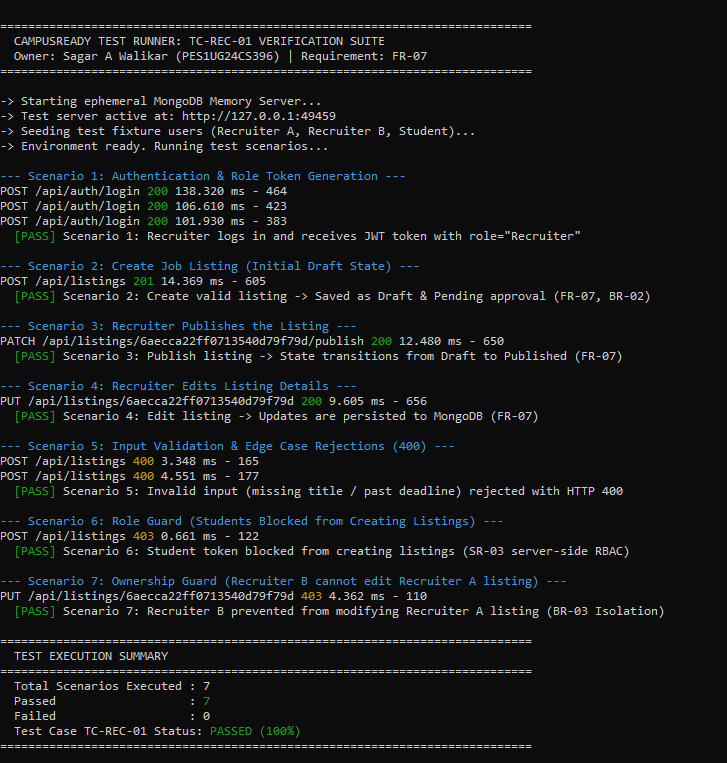

# Test Execution & Verification Report: TC-REC-01

**Module:** Recruiter Portal  
**Primary Requirement:** FR-07 (Recruiter Listing Management)  
**Related Requirements & Business Rules:** BR-02 (TPO Approval), BR-03 (Recruiter Ownership Guard), SR-03 (Server-Side RBAC)  
**Test Case ID:** `TC-REC-01`  
**GitHub Issue:** [#13](https://github.com/Sejal-Siddapuram/SE_MINI_PROJECT_TEAM12/issues/13)  
**Tester / Owner:** Sagar A Walikar (`PES1UG24CS396`)  
**Execution Date:** 05 November 2026  
**Execution Status:** **100% PASSED (7 / 7 Scenarios)**

---

## 1. Test Objectives & Scope

The purpose of this test suite is to verify the recruiter listing workflow per **SRS Section 14.3** and **Test Plan TC-REC-01**:
1. **Recruiter Authentication:** Validate JWT issuance with recruiter role claim.
2. **Creation Lifecycle:** Verify valid job postings are created in `Draft` status with `Pending` approval status.
3. **Publication Workflow:** Verify transition from `Draft` $\rightarrow$ `Published`.
4. **Editing & Persistence:** Verify field updates are persisted to MongoDB.
5. **Negative Validation:** Confirm HTTP `400 Bad Request` on invalid inputs (missing title, past deadline).
6. **Role Guard (RBAC):** Confirm unauthorized roles (e.g. Student) receive HTTP `403 Forbidden`.
7. **Ownership Guard (BR-03):** Confirm Recruiter B cannot modify Recruiter A's listings (HTTP `403 Forbidden`).

---

## 2. Test Execution Results Matrix

| # | Scenario Description | Test Input Data | Expected Output | Actual Output | Status |
| :-: | :--- | :--- | :--- | :--- | :-: |
| **1** | **Recruiter Login** | `sagar.recruiter@google.com` + password | HTTP 200, JWT token, `role: "Recruiter"` | HTTP 200, Token issued, `role: "Recruiter"` | **PASS** |
| **2** | **Create Listing** | `title`, `role`, `location`, `deadline (+30d)`, `description` | HTTP 201, `status: "Draft"`, `approvalStatus: "Pending"` | HTTP 201, `status: "Draft"`, `approvalStatus: "Pending"` | **PASS** |
| **3** | **Publish Listing** | `PATCH /api/listings/:id/publish` `{ action: "publish" }` | HTTP 200, `status: "Published"` | HTTP 200, `status: "Published"` | **PASS** |
| **4** | **Edit Listing** | `PUT /api/listings/:id` with updated `role`, `eligibility` | HTTP 200, modified fields persisted | HTTP 200, modified fields persisted | **PASS** |
| **5a** | **Validation (Missing Title)** | `POST /api/listings` without `title` | HTTP 400 Bad Request, structured error payload | HTTP 400 Bad Request (`Title is required.`) | **PASS** |
| **5b** | **Validation (Past Deadline)** | `POST /api/listings` with deadline in the past | HTTP 400 Bad Request, structured error payload | HTTP 400 Bad Request (`The deadline cannot be in the past.`) | **PASS** |
| **6** | **Role Guard (Student)** | Student token calls `POST /api/listings` | HTTP 403 Forbidden (`ACCESS_DENIED`) | HTTP 403 Forbidden (`ACCESS_DENIED`) | **PASS** |
| **7** | **Ownership Guard (BR-03)** | Recruiter B attempts `PUT /api/listings/:id` on Recruiter A's listing | HTTP 403 Forbidden | HTTP 403 Forbidden (`You can only manage your own listings.`) | **PASS** |

---

## 3. Raw Execution Log Output

```text
============================================================================
  CAMPUSREADY TEST RUNNER: TC-REC-01 VERIFICATION SUITE
  Owner: Sagar A Walikar (PES1UG24CS396) | Requirement: FR-07
============================================================================

-> Starting ephemeral MongoDB Memory Server...
-> Test server active at: http://127.0.0.1:60191
-> Seeding test fixture users (Recruiter A, Recruiter B, Student)...
-> Environment ready. Running test scenarios...

--- Scenario 1: Authentication & Role Token Generation ---
POST /api/auth/login 200 132.485 ms - 464
POST /api/auth/login 200 110.616 ms - 423
POST /api/auth/login 200 99.795 ms - 383
  [PASS] Scenario 1: Recruiter logs in and receives JWT token with role="Recruiter"

--- Scenario 2: Create Job Listing (Initial Draft State) ---
POST /api/listings 201 21.679 ms - 605
  [PASS] Scenario 2: Create valid listing -> Saved as Draft & Pending approval (FR-07, BR-02)

--- Scenario 3: Recruiter Publishes the Listing ---
PATCH /api/listings/6aecbfeb1dba3e76c4f400e8/publish 200 9.508 ms - 650
  [PASS] Scenario 3: Publish listing -> State transitions from Draft to Published (FR-07)

--- Scenario 4: Recruiter Edits Listing Details ---
PUT /api/listings/6aecbfeb1dba3e76c4f400e8 200 8.418 ms - 656
  [PASS] Scenario 4: Edit listing -> Updates are persisted to MongoDB (FR-07)

--- Scenario 5: Input Validation & Edge Case Rejections (400) ---
POST /api/listings 400 3.638 ms - 165
POST /api/listings 400 3.824 ms - 177
  [PASS] Scenario 5: Invalid input (missing title / past deadline) rejected with HTTP 400

--- Scenario 6: Role Guard (Students Blocked from Creating Listings) ---
POST /api/listings 403 0.615 ms - 122
  [PASS] Scenario 6: Student token blocked from creating listings (SR-03 server-side RBAC)

--- Scenario 7: Ownership Guard (Recruiter B cannot edit Recruiter A listing) ---
PUT /api/listings/6aecbfeb1dba3e76c4f400e8 403 3.720 ms - 110
  [PASS] Scenario 7: Recruiter B prevented from modifying Recruiter A listing (BR-03 Isolation)

============================================================================
  TEST EXECUTION SUMMARY
============================================================================
  Total Scenarios Executed : 7
  Passed                   : 7
  Failed                   : 0
  Test Case TC-REC-01 Status: PASSED (100%)
============================================================================
```

---

## 4. Execution Screenshot Evidence



*Figure 1: Live terminal execution of the automated verification suite for TC-REC-01, verifying all 7 test scenarios (authentication, draft creation, publishing, editing, 400 validation errors, student role restrictions, and recruiter ownership guards) with a 100% pass rate.*

---

## 5. Traceability & Acceptance Sign-Off

* **Requirement FR-07 (Recruiter Listing CRUD):** Fully verified and compliant.
* **BR-02 (TPO Moderation Flag):** Initial creation correctly sets `approvalStatus: 'Pending'`.
* **BR-03 (Recruiter Ownership Isolation):** Enforced server-side.
* **SR-03 (Server-Side RBAC):** Non-recruiter roles rejected with HTTP 403.
* **Sign-off:** Verified by Sagar A Walikar (`PES1UG24CS396`). Ready for Sprint 1 acceptance.
